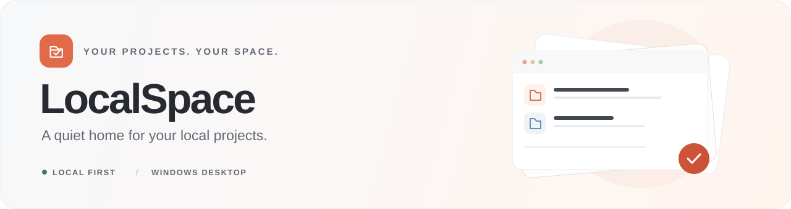
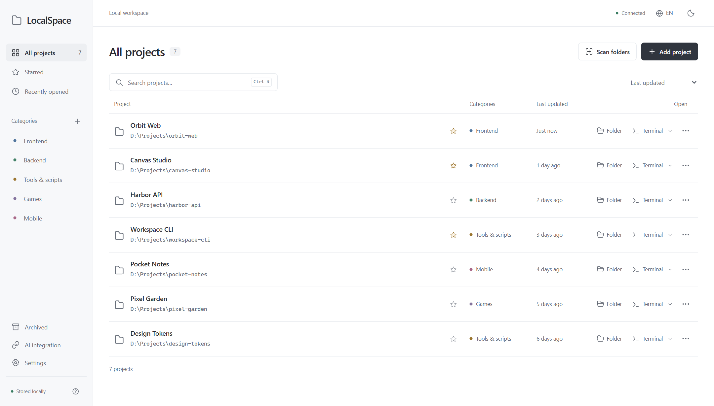
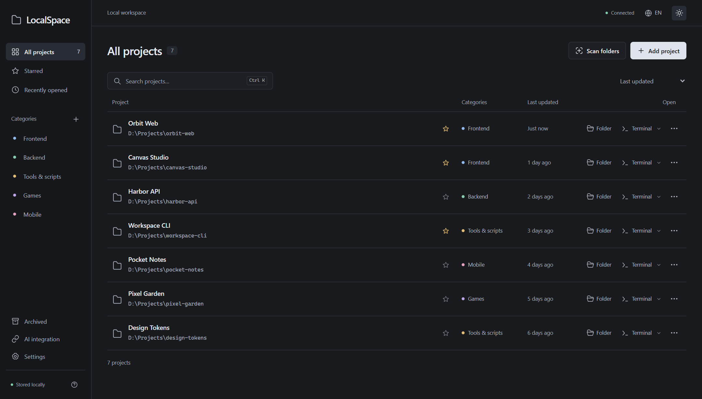

<div align="center">
  

  <p><strong>Find your project. Open your workspace. Get back to building.</strong></p>
  <p>A minimal, local-first project manager for Windows, built with Rust and TypeScript.</p>

  <p>
    
    
    
    
    <a href="LICENSE"></a>
  </p>

  <p><strong>English</strong> · <a href="README.zh-CN.md">简体中文</a></p>
  <p><a href="#preview">Preview</a> · <a href="#what-you-can-do">Features</a> · <a href="https://github.com/iDucklinqz/Local-Space/releases/latest">Download</a> ? <a href="#get-started">Get started</a> · <a href="#connect-your-ai-assistant">AI integration</a> · <a href="#development">Development</a></p>
</div>

---

LocalSpace brings scattered project folders into one quiet workspace. Scan a directory, preview what it finds, and keep the projects you need within reach. Open a folder or terminal directly from the list, with your files staying exactly where they are.

**No account, cloud backend, or model API key is required.** The Windows desktop app bundles its interface and local service into one executable; Node.js is only needed for development and the optional web version.

> **Languages:** English and Simplified Chinese. The interface follows your system language on first launch. Switch with the language button in the top bar or **Settings → Interface language**; your choice is remembered on this device.

## Preview

<picture>
  <source media="(prefers-color-scheme: dark)" srcset="docs/assets/overview-dark.png" />
  <source media="(prefers-color-scheme: light)" srcset="docs/assets/overview-light.png" />
  
</picture>

<p align="center"><sub>The real application, shown with fictional demo projects. Light and dark themes are built in.</sub></p>

<details>
<summary>View the dark theme</summary>



</details>

## What you can do

| | Capability | Details |
| :--- | :--- | :--- |
| **01** | **Discover your projects** | Scan local folders, review the results, and import selected projects. Existing repositories stay together. |
| **02** | **Keep things organized** | Create colored categories, add descriptions and technology tags, star favorites, and archive finished work. |
| **03** | **Find things quickly** | Search and sort the project list, browse recently opened projects, and focus search with `Ctrl+K` or `/`. |
| **04** | **Open your workspace** | Launch File Explorer, PowerShell, or CMD in the project directory. |
| **05** | **Connect your tools** | Let an external AI assistant register existing projects through JSON CLI commands or the loopback HTTP API. |
| **06** | **Stay in control** | Records live in a local JSON file. Archiving and removing records leave project files untouched. |

The scanner recognizes markers including `.git`, `package.json`, `pom.xml`, `pyproject.toml`, `Cargo.toml`, and `go.mod`. It skips hidden folders, dependency and build directories, and symbolic links. Each scan is limited to **600 projects** and **10,000 visited directories**, with warnings when limits are reached.

## Get started

### Download the Windows app

Download **`LocalSpace-1.1.0-windows-x64.zip`** from [GitHub Releases](https://github.com/iDucklinqz/Local-Space/releases/latest), extract it, and run `LocalSpace.exe`. The portable package includes the application, usage notes, and the GPL v3 license.

The app requires **Microsoft Edge WebView2 Runtime**. Node.js and Rust are not needed to use the desktop release. Source code and SHA-256 checksums are available alongside the download.

### Run the web version from source

Install **Node.js 22.12 or later**, then:

```powershell
git clone https://github.com/iDucklinqz/Local-Space.git
cd Local-Space
npm ci
npm run build
npm start
```

Open **http://127.0.0.1:4318** in your browser. Keep the service running while you use the app.

On Windows, you can also double-click `start.cmd`. It opens the packaged desktop app when `release/LocalSpace.exe` exists; otherwise, it prepares the web build when needed and opens the local web version.

### Build the Windows desktop app

In addition to Node.js, install the **Rust MSVC toolchain**, **Visual Studio C++ Build Tools**, and **Windows SDK**. The application uses the system **Microsoft Edge WebView2 Runtime**.

```powershell
rustup toolchain install stable-x86_64-pc-windows-msvc
npm ci
npm run desktop:package
```

The build creates:

```text
release/
├── LocalSpace.exe
├── README.txt
└── LocalSpace-1.1.0-windows-x64.zip
```

Launch `release/LocalSpace.exe`, or extract the ZIP and run the executable. The packaged app needs WebView2, but **does not need Node.js or Rust installed**. Closing the window exits the application.

Build outputs are generated locally and are excluded from this source repository.

## Connect your AI assistant

LocalSpace does not run a language model. Your existing assistant can use local commands to discover categories, list projects, and register folders. **Keep the desktop app open** while running its CLI commands:

```powershell
.\LocalSpace.exe categories
.\LocalSpace.exe list
.\LocalSpace.exe category "Experiments" --color blue
.\LocalSpace.exe add "D:\Projects\my-app" --category frontend --description "A React application" --tags "React,TypeScript"
.\LocalSpace.exe scan "D:\Projects" --depth 3
.\LocalSpace.exe scan "D:\Projects" --depth 3 --import
```

Run these from the folder containing `LocalSpace.exe`, or use its absolute path. Commands return JSON. Review scan results before using `--import`.

When working from source, use the equivalent Node.js CLI:

```powershell
npm run projects -- list --url http://127.0.0.1:4318
npm run projects -- add "D:\Projects\my-app" --category frontend --url http://127.0.0.1:4318
```

Without an explicit `--url`, the Node.js CLI first attempts to discover a running desktop session, then falls back to the web service at port `4318`.

See the [AI integration guide](AI-INTEGRATION.md) for argument handling, session discovery, HTTP endpoints, and error responses. The in-app **AI integration** action also provides copyable instructions.

## Your data stays local

| Mode | Workspace records | Default address |
| :--- | :--- | :--- |
| Windows desktop | `%LOCALAPPDATA%\LocalSpace\workspace.json` | `http://127.0.0.1:4319` |
| Web / development | `.localspace/workspace.json` in the checkout | `http://127.0.0.1:4318` |

- **Back up** `workspace.json` to preserve your project records, categories, and settings. Project source files remain in their original folders.
- On first desktop launch, an existing `.localspace/workspace.json` found in the working directory or nearby executable directories is copied into the desktop data directory. The original is preserved.
- Moving the executable after the initial setup does not move your workspace records; the desktop app continues to use the current Windows user's data directory.
- LocalSpace's service binds to loopback. Mutating API calls require the session token returned by `GET /api/state` in the `X-LocalSpace-Token` header.
- LocalSpace does not send project folders or source code to an AI service. Any external assistant you connect operates under its own configuration.

Use `LOCALSPACE_DATA_DIR` to choose a different data directory, or `LOCALSPACE_PORT` to change the service port. The native executable also accepts `--data-dir` and `--port`. The development UI's API proxy is configured for port `4318` in `vite.config.ts`; update it if you change the development service port.

## Development

The frontend uses **TypeScript, CSS, and Vite**. The Windows application uses **Rust, Wry, Tao, and WebView2**, with frontend assets embedded in the executable. A separate **Node.js standard-library server** supports web development and regression tests.

```powershell
npm ci
npm run dev
```

The Vite UI runs at **http://127.0.0.1:5173** and proxies API requests to the local Node.js service at port `4318`.

| Command | Purpose |
| :--- | :--- |
| `npm run dev` | Start the development UI and API service |
| `npm run build` | Type-check and build the frontend into `dist/` |
| `npm start` | Serve the built web application locally |
| `npm run desktop:package` | Build and package the Windows x64 executable |
| `npm test` | Run scanner, API, persistence, and request-isolation tests |
| `npm run test:ui` | Run browser interactions, responsive layout, and accessibility checks |
| `npm run test:i18n` | Verify language detection, switching, persistence, and translated workflows |
| `npm run docs:screenshots` | Refresh English and Chinese README screenshots after building the frontend |
| `npm run test:native` | Test the built native service and its browser UI |
| `npm run test:native-window` | Verify the native WebView2 window and workspace migration |

Browser tests need Playwright Chromium:

```powershell
npx playwright install chromium
npm test
npm run build
npm run test:ui
npm run test:i18n
```

For native checks, build the desktop package first, then run `npm run test:native` and `npm run test:native-window` on Windows. `LOCALSPACE_CHROMIUM` can point to an existing compatible browser executable; `LOCALSPACE_EXE` can select a different native build.

<details>
<summary><strong>Repository map</strong></summary>

```text
Local-Space/
├── src/                 TypeScript interface and CSS
├── public/              Application icon and favicon
├── server/              Node.js local API, storage, and scanner
├── desktop/             Rust desktop application and Cargo.lock
├── scripts/             Development, launch, CLI, and packaging tools
├── tests/               Core, browser, and native verification
├── docs/assets/         README artwork and demo screenshots
├── .cargo/config.toml   Shared static C runtime build configuration
├── AI-INTEGRATION.md    External assistant and HTTP API guide
├── README.md            English documentation
└── README.zh-CN.md      简体中文文档
```

Dependencies, build outputs, local workspace data, test artifacts, editor state, and local agent tooling are excluded through `.gitignore`. Source code, lockfiles, shared build configuration, and documentation assets are versioned.

</details>

## License

LocalSpace is licensed under the **GNU General Public License v3.0 only** (`GPL-3.0-only`). See [LICENSE](LICENSE) for the complete terms. Desktop ZIP packages include a copy as `LICENSE.txt`.
