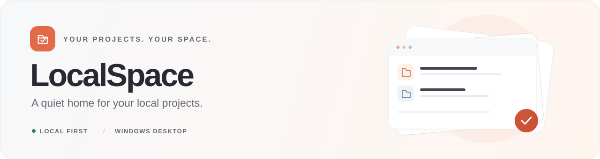
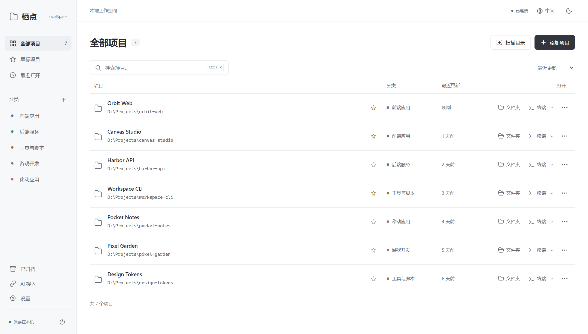
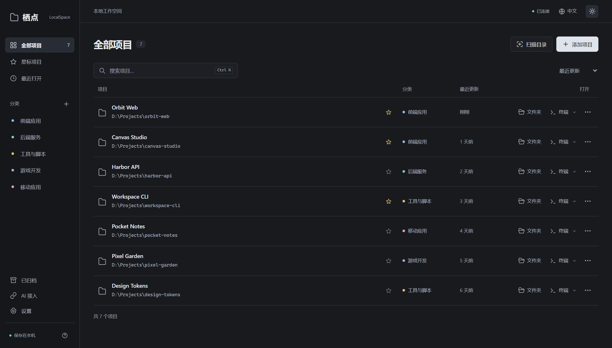

<div align="center">
  

  <p><strong>找到项目，打开工作区，继续创造。</strong></p>
  <p>用 Rust 与 TypeScript 构建的极简 Windows 本地项目管理工具。</p>

  <p>
    
    
    
    
    <a href="LICENSE"></a>
  </p>

  <p><a href="README.md">English</a> · <strong>简体中文</strong></p>
  <p><a href="#界面预览">界面预览</a> · <a href="#主要功能">主要功能</a> · <a href="#快速开始">快速开始</a> · <a href="#接入你的-ai-助手">AI 接入</a> · <a href="#开发与验证">开发与验证</a></p>
</div>

---

栖点把散落在各处的项目文件夹整理到一个安静的工作台。扫描目录、预览结果、按需导入，再从列表直接打开文件夹或终端。项目文件始终保留在原来的位置。

**无需账号、云端后端或模型 API Key。** Windows 桌面版将界面与本地服务打包进单个可执行文件；只有开发和使用可选的网页版本时才需要 Node.js。

> **界面语言：**支持 English 和简体中文，首次启动时跟随系统语言。可通过顶部语言按钮或 **设置 → 界面语言** 切换，选择会保存在当前设备。

## 界面预览

<picture>
  <source media="(prefers-color-scheme: dark)" srcset="docs/assets/overview-zh-CN-dark.png" />
  <source media="(prefers-color-scheme: light)" srcset="docs/assets/overview-zh-CN-light.png" />
  
</picture>

<p align="center"><sub>真实应用界面，使用虚构的演示项目。内置浅色与深色主题。</sub></p>

<details>
<summary>查看深色主题</summary>



</details>

## 主要功能

| | 功能 | 说明 |
| :--- | :--- | :--- |
| **01** | **发现本地项目** | 扫描目录，预览结果，选择需要导入的项目；仓库作为整体登记。 |
| **02** | **整理项目资料** | 自定义彩色分类，添加简介和技术标签，收藏常用项目，归档已完成的工作。 |
| **03** | **快速找到目标** | 搜索、排序、查看最近打开的项目，按 `Ctrl+K` 或 `/` 聚焦搜索。 |
| **04** | **直接进入工作区** | 一键打开文件资源管理器，或在项目目录启动 PowerShell、CMD。 |
| **05** | **连接现有工具** | 外部 AI 助手可通过返回 JSON 的 CLI 或本机 HTTP API 登记已有项目。 |
| **06** | **数据由你掌握** | 项目记录保存在本地 JSON 文件中；归档和移除登记不会修改项目文件。 |

扫描器通过 `.git`、`package.json`、`pom.xml`、`pyproject.toml`、`Cargo.toml`、`go.mod` 等标识识别项目，跳过隐藏目录、依赖目录、构建目录及符号链接。每次最多识别 **600 个项目**、访问 **10,000 个目录**，达到上限时会提示。

## 快速开始

### 从源码运行网页版本

安装 **Node.js 22.12 或更高版本**，然后执行：

```powershell
git clone https://github.com/iDucklinqz/Local-Space.git
cd Local-Space
npm ci
npm run build
npm start
```

浏览器打开 **http://127.0.0.1:4318**。使用期间保持本地服务运行。

Windows 下也可以双击 `start.cmd`：如果存在 `release/LocalSpace.exe`，会直接启动桌面版；否则按需准备网页构建并打开本地网页版本。

### 构建 Windows 桌面版

除 Node.js 外，还需要 **Rust MSVC 工具链**、**Visual Studio C++ 构建工具**和 **Windows SDK**。应用使用系统中的 **Microsoft Edge WebView2 Runtime**。

```powershell
rustup toolchain install stable-x86_64-pc-windows-msvc
npm ci
npm run desktop:package
```

构建后生成：

```text
release/
├── LocalSpace.exe
├── README.txt
└── LocalSpace-1.1.0-windows-x64.zip
```

运行 `release/LocalSpace.exe`，或解压 ZIP 后启动其中的程序。打包后的应用需要 WebView2，**无需安装 Node.js 或 Rust**。关闭窗口即退出程序。

构建产物在本地生成，不包含在源码仓库中。

## 接入你的 AI 助手

栖点不运行语言模型。你现有的 AI 助手可以调用本机命令，读取分类、列出项目并登记文件夹。执行桌面版 CLI 命令时，**保持栖点窗口打开**：

```powershell
.\LocalSpace.exe categories
.\LocalSpace.exe list
.\LocalSpace.exe category "个人实验" --color blue
.\LocalSpace.exe add "D:\Projects\my-app" --category frontend --description "一个 React 应用" --tags "React,TypeScript"
.\LocalSpace.exe scan "D:\Projects" --depth 3
.\LocalSpace.exe scan "D:\Projects" --depth 3 --import
```

在 `LocalSpace.exe` 所在目录执行，或改用 exe 的绝对路径。命令返回 JSON；使用 `--import` 前先查看扫描预览。

源码运行方式支持等价的 Node.js CLI：

```powershell
npm run projects -- list --url http://127.0.0.1:4318
npm run projects -- add "D:\Projects\my-app" --category frontend --url http://127.0.0.1:4318
```

未显式指定 `--url` 时，Node.js CLI 会优先尝试发现正在运行的桌面会话，之后回退到 `4318` 端口的网页服务。

参数处理、会话发现、HTTP 接口和错误响应详见 [AI 接入说明](AI-INTEGRATION.zh-CN.md)。界面中的 **AI 接入** 也提供可直接复制的调用说明。

## 数据保存在本地

| 运行方式 | 工作台记录 | 默认地址 |
| :--- | :--- | :--- |
| Windows 桌面版 | `%LOCALAPPDATA%\LocalSpace\workspace.json` | `http://127.0.0.1:4319` |
| 网页版 / 开发环境 | 当前仓库的 `.localspace/workspace.json` | `http://127.0.0.1:4318` |

- **备份** `workspace.json` 即可保留项目记录、分类和设置，项目源码仍位于原来的文件夹。
- 桌面版首次启动时，会把工作目录或 exe 附近目录中找到的已有 `.localspace/workspace.json` 复制到桌面数据目录，原文件保留。
- 完成初次设置后，移动 exe 不会移动工作台记录；程序仍使用当前 Windows 用户的数据目录。
- 本地服务仅监听回环地址。修改数据的 API 请求需要先从 `GET /api/state` 获取会话令牌，并放入 `X-LocalSpace-Token` 请求头。
- 栖点不会向 AI 服务发送项目目录或源码；你连接的外部助手遵循其自身配置。

可用 `LOCALSPACE_DATA_DIR` 自定义数据目录，或用 `LOCALSPACE_PORT` 更改服务端口。原生程序也支持 `--data-dir` 和 `--port`。开发界面的 API 代理在 `vite.config.ts` 中固定指向 `4318`；修改开发服务端口时，也需同步更新代理配置。

## 开发与验证

前端使用 **TypeScript、CSS 和 Vite**；Windows 桌面程序使用 **Rust、Wry、Tao 和 WebView2**，前端资源内嵌到 exe 中。独立的 **Node.js 标准库服务**用于网页开发和回归验证。

```powershell
npm ci
npm run dev
```

Vite 开发界面位于 **http://127.0.0.1:5173**，API 请求代理到 `4318` 端口的本地 Node.js 服务。

| 命令 | 用途 |
| :--- | :--- |
| `npm run dev` | 启动开发界面与 API 服务 |
| `npm run build` | 类型检查并构建前端到 `dist/` |
| `npm start` | 在本机提供构建后的网页应用 |
| `npm run desktop:package` | 构建并打包 Windows x64 程序 |
| `npm test` | 验证扫描、API、持久化与请求隔离 |
| `npm run test:ui` | 浏览器交互、响应式布局与无障碍检查 |
| `npm run test:i18n` | 验证语言识别、切换、偏好保存和翻译后的操作流程 |
| `npm run docs:screenshots` | 构建前端后，更新中英文 README 截图 |
| `npm run test:native` | 验证编译后的原生服务及其浏览器界面 |
| `npm run test:native-window` | 验证原生 WebView2 窗口与工作台迁移 |

浏览器测试需要安装 Playwright Chromium：

```powershell
npx playwright install chromium
npm test
npm run build
npm run test:ui
npm run test:i18n
```

原生验证需要先构建桌面包，再在 Windows 下运行 `npm run test:native` 和 `npm run test:native-window`。`LOCALSPACE_CHROMIUM` 可指定已有的兼容浏览器程序，`LOCALSPACE_EXE` 可指定其他原生构建。

<details>
<summary><strong>仓库结构</strong></summary>

```text
Local-Space/
├── src/                 TypeScript 界面与 CSS
├── public/              应用图标与 favicon
├── server/              Node.js 本地 API、存储与扫描器
├── desktop/             Rust 桌面程序与 Cargo.lock
├── scripts/             开发、启动、CLI 与打包工具
├── tests/               核心、浏览器及原生验证
├── docs/assets/         README 视觉素材与演示截图
├── .cargo/config.toml   共享的 C 运行库静态链接配置
├── AI-INTEGRATION.md    英文外部助手及 HTTP API 说明
├── README.md            默认英文文档
└── README.zh-CN.md      简体中文文档
```

依赖、构建产物、本地工作台数据、测试产物、编辑器状态和本地代理工具均由 `.gitignore` 排除。源码、锁文件、共享构建配置和文档素材纳入版本管理。

</details>

## 开源协议

LocalSpace 采用 **GNU 通用公共许可证第 3 版**（仅限 v3，`GPL-3.0-only`）。完整条款见 [LICENSE](LICENSE)。桌面 ZIP 包内也附有协议副本 `LICENSE.txt`。
